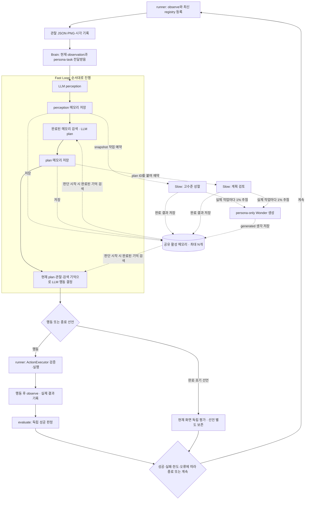

# Brain과 두 루프 설계 초안

작성일: 2026-10-14, 갱신: 2026-10-15. 상태: **#39 기록 계약, #41 Fast 단계, #42 Slow 작업, #43 Brain 조율 구현; 브라우저/평가 경로 재구성은 후속**.

이 문서는 현재 코드, UXAgent 논문, 사용자가 원하는 변경을 대조한다. [#39](https://github.com/2026-2-1/Persona/issues/39)의 기록 스키마·단조 메모리 순번, [#41](https://github.com/2026-2-1/Persona/issues/41)의 Fast 단계별 생성·기록, [#42](https://github.com/2026-2-1/Persona/issues/42)의 Slow reflection/plan review 예약·기록, [#43](https://github.com/2026-2-1/Persona/issues/43)의 실행별 Brain 조율을 구현했다. 사용자가 정한 무제한 대기열, 무제한 요청/토큰 기본값, 종료 시 취소 정책을 반영한다.

## 1. 목표와 이번에 정한 내용

페르소나별 실행에 `brain.py`를 두고 Fast Loop, Slow Loop, 공유 메모리를 조율한다. Fast Loop는 perception → planning → action decision을 단계별로 수행한다. Slow Loop는 비동기 성찰·계획 검토를 수행하고, 드물게 과업과 무관한 persona 기반 생각을 생성한다. 이 문서의 5점 고정 정책은 #42 당시 결정 기록이며, #40에서 새 기억을 미산정으로 저장하고 Slow가 1~10점으로 산정하도록 변경했다. 현재 계약은 [#40 작업](../tasks/40-memory-importance.md)을 따른다.

사용자가 확정한 방향:

- 실제 AI 실행에서는 두 루프를 항상 구성하고 활성화한다. 객체만 만든 상태를 두 루프가 작동한 것으로 기록하지 않는다.
- `observe()` 이후에는 관찰과 근거를 먼저 저장하고 Brain으로 진행한다. Brain 진입 전에 성공 평가로 실행을 조기 종료하는 현재 경로는 목표 흐름에서 제거한다.
- Fast Loop는 방금 예약한 Slow Loop 결과를 기다리지 않는다. **완료된 결과만 이후의 계획·행동 판단에 반영한다.**
- Brain이 행동을 결정하면 ActionExecutor가 검증·실행하고, 실제 행동 이후의 화면으로 독립 성공 판정을 한다.
- 기존 활성 메모리 상한은 유지하고 Slow 작업 대기열에는 별도 상한을 두지 않는다.
- Slow Loop의 실제 작업 호출마다 1/100 확률로 persona만을 바탕으로 한 과업 밖 생각을 추가한다. 확률의 적용 단위와 예산 처리는 아래 제안과 미정 항목을 함께 확인한다.

이 변경은 우선 페르소나의 실제 AI 실행을 위한 설계다. 일반/페르소나 비교 기능의 제거 여부, 동시 batch 실행, 브라우저 로딩 기준 개선은 이 문서에서 결정하지 않는다.

## 2. 현재 구현과의 차이

| 항목 | 현재 코드에서 확인한 동작 | 변경 목표 |
|---|---|---|
| 조율 | [runner.py](../../src/uxagent/runner.py)의 `run_study()`가 관찰·실행·평가 수명주기를 맡고 [brain.py](../../src/uxagent/brain.py)가 Fast/Slow 단계와 결과 채택을 조율 | browser/evaluator 책임을 Brain 내부로 옮기지 않음 |
| 첫 평가 | 관찰 후 `evaluate()`가 success면 LLM 호출 없이 종료 | 근거 저장 후 Brain을 거치고 행동/종료 선언 뒤 평가 |
| Fast Loop | [fast_loop.py](../../src/uxagent/fast_loop.py)가 perception·plan·decision을 별도 호출로 수행. Jev도 생성 fallback으로 인식·계획을 만들고 행동은 후보 선택 | 단계별 기억 검색·저장 뒤 Slow 작업을 예약; 전체 조율은 #43 |
| Slow Loop | 모든 AI 실행에서 실행별 단일 worker. perception 뒤 성찰, plan 뒤 검토를 예약; legacy `enable_slow_loop` 값은 true로 정규화 | 무제한 대기열, 기본 무제한 요청/토큰, 종료 시 미완료 취소 |
| Slow 입력 | [slow_loop.py](../../src/uxagent/slow_loop.py)가 reflection과 plan review를 순차 비동기 처리하며 작업 시작 시 깊은 복사 snapshot을 사용 | 별도 대기열 제한 없이 예약, 작업 상태·출처·모델 기록 |
| 점수 | 중요도는 5로 고정. 검색은 관련도·최신성 등 기존 I/Q/R 검색을 사용 | 중요도 차이를 다시 도입할지와 단계별 검색 우선순위는 후속 결정 |
| 모델에 전달되는 기억 | 검색 결과는 점수 내림차순이지만 최근 행동을 뒤에 붙인 후 Fast는 `[-6:]`, Jev는 `[-4:]`만 전달. 기본 최근 이력 6개가 차면 일반 생성 경로의 검색 기억은 모두 제외됨 | 점수로 선택한 top-k와 최근 행동 이력을 분리해 실제 입력에 보존 |
| 메모리 상한 | 활성 저장은 기본 64개(10~64 설정). #45에서 Wonder를 먼저 제거하고 최근 10개 과업 기억을 보호 | 현재 고정 점수가 모두 5이므로 나머지 동점은 생성 순번으로 처리; `memory_limit`과 N은 별도 설정 |
| Wonder | #45에서 기본 활성화. 시작된 Slow 작업마다 1% 추첨 후 별도 persona 입력으로 비동기 생성 | 추첨 seed·부모 작업 ID·생성 가정·상태 기록 |
| 행동 | [actions.py](../../src/uxagent/actions.py)가 최신 observation·탭·capability·허용 origin을 확인하고 실행 | Brain도 실행 권한을 직접 갖지 않고 기존 실행 경계를 사용 |
| 평가 | [evaluator.py](../../src/uxagent/evaluator.py)는 현재 Page와 등록 조건을 검사하는 함수이며 observation 저장소가 아님 | 저장 책임과 성공 판정 책임을 명시적으로 구분 |

Slow generation completion과 Fast adoption은 분리 기록한다. Reflection은 다음 Fast stage 경계에서 provenance를 확인한 뒤 채택한다. Plan review는 같은 observation/plan/version의 decision 시작 전에 완료됐을 때만 채택하고, stale 결과는 폐기한다. 실행 종료는 진행 중·대기 작업 취소로 기록한다. 짧은 실행이 두 루프를 실제로 거쳤는지는 예약·완료·채택·취소 기록으로 구분한다.

## 3. 논문에서 가져오는 근거와 프로젝트의 선택

기준 자료는 저장소가 이미 참조한 **UXAgent, arXiv:2504.09407v3, 2025-09-19 버전**이다. 다음은 원문에서 확인한 내용만 요약한 것이다.

| 논문 근거 | 설계에 적용할 의미 |
|---|---|
| §3.2.1, Fig. 2: Fast의 Perception/Planning/Action과 Slow의 Reflection/Wonder가 공유 메모리로 병렬 동작 | 두 루프를 조율하되 완료된 생각을 이후 판단에 활용한다. [원문](https://arxiv.org/html/2504.09407v3#S3.SS2.SSS1) |
| PDF §3.2.2 Memory Stream: 중요도·관련도·최신성·메모리 종류로 검색; Fast는 최신성, Slow는 관련성 강조 | 현재 프로젝트에서는 신규 중요도를 모두 5로 고정해 Slow가 중요도 점수로 기억을 차등 선택하지 않는다. [고정 버전 PDF](https://arxiv.org/pdf/2504.09407v3) |
| 중요도는 Slow에서 LLM으로 계산하며 미산정 메모리는 검색할 수 있고 중요도 항만 무시 | 최초 메모리가 점수 없이도 계획에 사용될 수 있어야 한다. [원문](https://arxiv.org/html/2504.09407v3#S3.SS2.SSS1) |
| Wonder는 persona와 memory stream을 사용하며 C.6은 관련 또는 무관한 생각 0~3개를 허용 | **persona-only, 과업 밖 생각 하나, 호출당 1%, 활성 N개 상한, 별도 계획 검토, 독립 evaluator**는 프로젝트 요구다. 논문이 이 설정을 요구한다고 쓰지 않는다. [Appendix C.6](https://arxiv.org/html/2504.09407v3#A3.SS6) |

논문의 인간 행동 재현 한계도 고려한다. 생성된 생각과 성찰을 실제 사용자의 사고나 검증된 인간 행동으로 설명하지 않는다. [§5.4 한계](https://arxiv.org/html/2504.09407v3#S5.SS4)

본문 번호는 PDF 기준이다. arXiv HTML에서는 Memory Stream 절 번호가 누락되어 Architecture 설명에 이어 표시된다. Appendix C.7의 중요도 척도는 1~10이다. #39의 새 `MemoryEntry` 2.0과 점수 변경 사건은 1~10을 사용하고 구버전 1.0의 0~5는 버전별로 읽는다. #40 작업 브랜치에서 행동 뒤 저장한 기억의 중요도를 LLM으로 비동기 산정한다. [Appendix C.7](https://arxiv.org/html/2504.09407v3#A3.SS7)

## 4. 한 행동 차례의 흐름

실선은 기다려서 처리하는 흐름이고 점선은 비동기 예약/메모리 교환이다. 점선에는 같은 차례의 결과 반영 보장이 없다.

순서별 의미:

1. **관찰 기록:** observe는 현재 브라우저 DOM을 관찰하고 실행용 registry를 만든다. 원본 관찰 근거는 storage/runner가 보존한다. evaluator에 observation을 저장하는 것으로 구현하지 않는다.
2. **Perception:** Fast의 첫 LLM 요청이 현재 관찰을 persona 관점에서 짧게 해석한다. 결과를 `generated` 메모리로 저장하고 원래 `observation_id`를 연결한다. 실제 관찰과 LLM 해석을 같은 사실로 취급하지 않는다.
3. **성찰 예약:** perception 저장 직후 Slow 작업을 예약한다. 작업 시작 시 활성 메모리의 깊은 복사 snapshot을 만들고 최신 순번·출처를 기록한다. 현재 중요도는 모두 5로 고정되어 점수 차이로 기억을 구분하지 않는다. Fast는 작업 완료를 기다리지 않는다.
4. **Planning:** Fast가 그 시점에 완료되어 저장된 기억을 최신성 우선으로 검색해 계획을 만든다. 방금 예약한 성찰은 아직 없을 수 있다. 만들어진 계획도 메모리에 저장한다.
5. **계획 검토 예약:** Slow에 해당 계획과 근거를 넘긴다. 이는 persona·intent와 계획의 일관성 및 텍스트 수정 제안을 위한 호출이다. 검토 결과는 계획을 직접 바꾸지 않으며 과업 성공 판정이나 행동 허가가 아니다.
6. **Action decision:** Fast가 현재 계획, 최신 관찰의 행동 공간, 점수로 선택한 기억을 받아 구체적인 행동 하나 또는 종료 선언을 만든다. 결정은 현재 `observation_id`/`tab_id`에 묶고 생성된 제안으로 저장한다.
7. **실행·평가:** runner의 ActionExecutor가 실제로 실행한다. 실행 결과와 이후 관찰을 기록하고 공유 메모리에도 실제 결과/오류를 추가한다. 제안·실행 시도·확인된 화면 효과는 구분한다. 독립 evaluator는 이후 페이지 상태를 검사하며 결정문만 평가해서 실제 성공으로 표시하지 않는다.
8. **다음 차례:** 아직 끝나지 않았다면 새 관찰을 기준으로 Brain에 들어간다. 지난 Slow 결과 중 완료되어 현재 상황에 유효한 결과가 이번 계획/행동에 반영될 수 있다.

이 문서의 perception·planning·decision은 순차적인 별도 LLM 요청을 목표로 한다. 현재의 한 응답에서 세 필드를 받는 방식만 유지하면 사용자가 요구한 중간 저장·비동기 예약 경계를 구현했다고 볼 수 없다.

## 5. Brain과 주변 모듈의 책임

| 구성요소 | 담당 책임 | 입출력 관계 |
|---|---|---|
| runner | 브라우저·deadline·중지·실행 ID·원자료 연결 | observe → Brain → executor → observe → evaluator 조율 |
| Brain | 실행별 두 루프 구성, 단계별 문맥·snapshot 검증, Slow 결과 채택·수명주기 | 입력: observation·persona·task·행동 결과/오류·남은 단계; 출력: Fast 행동 제안/종료 선언과 메모리·호출 기록 |
| Fast Loop | persona 기반 perception, plan, action decision | 기록 가능한 짧은 해석·계획·행동을 각각 생성 |
| Slow Loop | 성찰, 계획 검토, 기존 Wonder 선택 옵션 | snapshot 결과를 만들고 Brain이 다음 단계에서 검증/채택; 브라우저 직접 조작 금지 |
| MemoryStore | 검색 점수, 활성 N개 상한, 제거, 독립적인 항목 ID/순번 | 모든 작성자를 한 경계에서 처리; 원자료 로그는 별도 보존 |
| ActionExecutor | 최신 registry·origin·대상 검증과 실제 실행 | Brain의 제안을 실행한 실제 결과 반환 |
| evaluator | 등록된 성공 조건을 실제 페이지 상태로 검사 | 전체 verification은 success/failure/unknown, 개별 feature check는 pass/fail/unknown으로 근거 반환; 평가 정답을 Brain 프롬프트에 넣지 않음 |
| storage | 관찰·행동·생성 메모리·판정의 근거 보존 | 평가기나 활성 메모리 제거가 기록 삭제를 대신하지 않음 |

Brain은 실행마다 새로 만든다. 다른 페르소나/실행의 메모리나 Slow 작업을 공유하지 않는다. 일반 조건의 Slow는 persona background/preferences 없이 constraints와 intent만 받는다.

## 6. 비동기 결과를 반영하는 규칙

**확정:** Fast는 Slow를 기다리지 않으며 단계 시작에서 완료된 기억만 가져온다.

- perception 후 예약한 성찰은 다음 stage 시작 시 완료된 결과만 provenance 검사 뒤 채택한다. 해당 stage의 프롬프트가 이미 시작된 뒤 완료된 결과는 그 입력을 바꾸지 않는다.
- plan 검토는 같은 observation ID·plan ID·version을 가진 decision 시작 전에 완료된 경우에만 해당 decision의 검색 문맥으로 채택한다. 새로운 observation/plan이면 stale 폐기한다.
- 검토 결과의 `plan_id`, 계획 버전, `observation_id`, snapshot 기준 순번, 출처 메모리 ID는 `BrainStageRecord`와 `BrainTaskEvent`에 기록한다. 실제 호출 모델은 `llm_calls.jsonl`의 task ID와 작업 결과 stage ID를 통해 연결한다.
- 오래된 계획 검토가 새 계획이나 행동 제안을 덮어쓰지 않는다. 검토 내용은 텍스트이며 행동 결정의 현재 observation ID와 ActionExecutor의 최신 registry 검사를 유지한다.
- Fast 입력을 만든 뒤 Slow가 끝났다면 그 입력은 중간에 변경하지 않는다. 어느 기억이 실제 판단 입력에 포함됐는지를 기록한다.
- snapshot은 작업 시작 때의 내용과 점수를 고정한 사본으로 만든다. 현재의 목록 복사만 유지한 채 메모리 객체를 나중에 수정하면, 작업이 보고 있는 snapshot도 바뀔 수 있다.

**사용자 결정:** Slow 작업은 순차 실행하고 대기열 상한을 두지 않는다. 요청·총토큰 기본 한도는 무제한이다. worker는 예약·시작·생성 완료·채택·폐기·실패·취소·설정한 경우 예산 생략을 기록한다. 실행 종료 시 활성 작업과 대기 작업은 취소한다. #43에서 결과 유효성·채택 경계를 구현했다.

필수 활성은 실제 AI run마다 두 루프를 구성한다는 의미다. 사용자가 정한 기본 예산은 무제한이며, 실행 timeout·중지·provider 실패는 그대로 기록한다. 실패/취소/생략이 있으면 Brain summary는 incomplete이며 정상 two-loop 완료로 표시하지 않는다.

## 7. 메모리 점수와 최대 N개

### 점수 역할

| 점수 | 의미 | 산정 방법 제안 |
|---|---|---|
| 중요도 I | persona의 과업/intent 수행에 중요한 정보인가 | 현재 실행에서는 모든 신규 기억을 5로 고정하며 LLM 산정은 하지 않음 |
| 최신성 R | 얼마 전에 생성됐는가 | 현재 시각과 생성 시각의 차이로 감소; 단위와 감소 속도를 설정 |
| 관련성 Q | 지금의 계획·판단 질문과 얼마나 관계가 있는가 | 현재 keyword/선택적 embedding 검색을 활용할지 결정 |

초기 기준선은 I/Q/R 동일 가중치다. Fast 계획과 Slow 성찰의 서로 다른 검색 우선순위는 #54에서 보완한다. 최신성만 쓰면 새 Wonder가 유용한 오래된 제약보다 앞설 수 있다. 현재 관찰·현재 계획·persona의 과업 제약은 별도 필수 문맥으로 전달하고, 나머지 기억은 점수로 고르는 것을 제안한다.

점수로 고른 top-k 기억과 최근 행동 이력은 #40의 첫 단계에서 Fast 입력 필드로 분리했다. 높은 점수부터 고른 목록 뒤에 이력을 붙이고 마지막 몇 개만 자르면 선택된 기억이 모델 입력에서 빠진다. 중요도가 갱신돼도 원래 생성 시각을 바꾸지 않으며, 읽었다는 이유로 최신 기억으로 다시 취급하지 않는다.

#42의 현재 정책은 새 메모리의 중요도를 5로 고정하는 것이다. 따라서 Slow는 중요도 차이로 후보를 우선하지 않고 동점일 때 최신 순번을 사용한다. 예전 제안의 미산정 기억 점수화는 적용하지 않는다. 현재 perception은 현재 계획·행동이 끝나기 전에 제거되지 않도록 보호해야 한다.

### 활성 메모리 제거

**사용자 확정 정책:** 활성 메모리는 기본 최대 64개이며, 설정 가능한 N의 범위는 10~64개다. 한 번에 검색해 모델에 넘기는 `memory_limit`와 활성 저장 상한 N은 별개다. N을 넘기면 가장 최근에 생성된 10개를 먼저 보호하고, 남은 N-10개 자리는 중요도 높은 순서로 채운다. 현재 모든 신규 중요도가 5이므로 동점은 더 최근에 생성된 기억을 남긴다. 기존 기억을 다시 읽어도 생성 순번과 시각은 바뀌지 않는다.

현재 프로젝트 결정에 따라 새 메모리 중요도는 5로 고정되어 활성 상한 제거는 생성 순번으로 동점을 해소한다. 기존 구버전 0~5점과 제거 사건 스키마는 호환성을 위해 유지한다.

최신 10개 보호와 활성 64개 상한은 [UXAgent 논문](https://arxiv.org/html/2504.09407v3)의 수치가 아니라 이 프로젝트에서 정한 보존 정책이다. 논문의 중요도 척도 1~10과 중요도·관련성·최신성 검색 개념은 별도로 따른다.

제거 규칙에 필요한 보호:

- 활성 메모리에서 잊어도 JSONL 원자료·관찰 PNG와 출처는 남긴다. 실행 결과를 나중에 검토할 수 있어야 한다.
- N에는 perception·plan·action·reflection·plan review·Wonder를 합친 활성 항목 수를 센다. 필수 문맥의 보호 범위와 N이 너무 작은 경우의 처리도 정의한다.
- 기존 `seq=len(entries)+1`과 Slow의 `based_on=len(snapshot)`는 제거 이후 올바른 순번이 될 수 없었다. #39에서 별도 증가 순번과 snapshot의 실제 최대 순번으로 바꿨다.
- 제거된 메모리를 참조하는 늦은 Slow 결과는 당시 snapshot과 보존 로그에 근거를 연결한다. 사라졌다고 새 ID로 재생성하거나 출처를 지우지 않는다.
- embedding cache에서도 제거된 활성 항목의 데이터를 정리하고, 추가·점수 갱신·제거를 일관된 경계에서 처리한다.

메모리의 기존 kind는 유지하고 `importance`/`perception`/`plan_review`는 `BrainStageRecord.stage`로 구분한다. #40에서 정의한 점수 변경/활성 메모리 제거 사건 계약은 유지하지만 현재 새 점수는 5로 고정되어 LLM 점수 갱신을 실행하지 않는다. #43 Brain 조율은 구현됐으며 실험 품질 평가는 후속이다.

## 8. 1/100 확률의 persona-only Wonder

사용자 의도: 과업과 상관없는 취미·음식 등의 생각을 persona만으로 만들어 자연스러운 주의 분산을 실험한다. 실제 사용자가 떠올린 생각이나 확정된 개인 선호로 취급하지 않는다.

호출 규칙 제안:

1. 성찰 또는 계획 검토 작업이 실제로 시작될 때 추첨을 한 번 한다. 같은 작업의 네트워크 재시도에는 다시 추첨하지 않는다. 현재는 중요도 산정 요청을 실행하지 않는다.
2. 확률은 0.01이다. 당첨이면 persona와 짧은 생성 지침만 주어 별도 LLM 요청을 비동기로 실행한다. 현재 DOM·평가 정답·과업 메모리는 입력하지 않는다.
3. 출력은 과업과 무관한 짧은 생각 하나이며 `generated`/Wonder로 저장한다. persona에 없는 취향을 보충했다면 가정임을 명시한다.
4. 별도 Wonder 요청도 공통 요청·토큰·시간 예산에 포함한다. 예산이 없으면 생성하지 못했다는 상태를 남긴다.
5. 실행별 난수 seed와 추첨 대상 작업 ID, 추첨 결과를 기록한다. 비동기 완료 순서까지 같아진다고 보장하지 않으며 실제 snapshot/완료/채택 순서도 보존한다.

성찰과 계획 검토를 한 차례에 둘 다 실행한다면 추첨은 두 번이 된다. 그러므로 0.01은 **행동당 확률이 아니라 실제 Slow 작업당 확률**이다. #45에서 이 단위를 채택했다.

#45에서 기존 `next_focus` 저장 경로를 제거하고 별도 persona 입력 생성을 구현했다. 입력에서 `intent`도 제외하고, 일반 AI 조건에는 공통 제약만 전달한다. 1%가 실제 사람의 주의 분산 확률이라는 근거는 주장하지 않는다.

## 9. LLM 호출 비용과 제공자 호환

Fast의 perception·planning·decision을 별도 요청으로 하면 행동 차례당 기본 3회다. 성찰과 계획 검토 작업이 실제 완료되면 요청이 각각 추가된다. 중요도 점수는 5로 고정하므로 점수 산정 요청은 없다. 재시도·embedding·Wonder도 추가될 수 있다.

현재 기본값은 `max_steps=30`이고, 사용자의 임시 결정에 따라 `max_llm_requests`와 `max_total_tokens`는 `null`(총량 제한 없음)이다. 두 값에 양의 정수를 지정하면 기존 예산 검사를 적용한다. 실행 시간과 요청별 출력 토큰 상한은 남아 있다. 실제 호출 수와 비용은 계속 기록하며, 비용을 확인할 수 없으면 0으로 표시하지 않는다.

Jev는 행동 후보 분류용이다. #46에서 perception·planning·reflection·plan review·Wonder와 decision fallback에는 선택한 Gemini 모델을 배정하고, Jev의 후보 선택과 구분해 호출별 실제 provider/model을 기록한다. 선택한 모델의 계정별 접근 가능 여부는 실제 API 연결로 별도 확인해야 한다.

일반/페르소나 비교는 두 조건에 각각 독립 Brain과 메모리를 둔다. 일반 조건 Fast/Slow에는 persona 배경·선호를 전달하지 않고 constraints/intent만 전달한다. 비교는 여전히 mock 기반일 때 시스템 흐름 검사이며 실제 persona 효과의 증거가 아니다.

## 10. 구현 전에 남은 결정과 제안

| 항목 | 현재 합의/요구 | 남은 결정 또는 제안 |
|---|---|---|
| 비동기 결과 | #43: stage 경계에서 완료된 결과만 채택; plan review는 동일 observation/plan/version decision에 한정, stale 폐기 | 해결. 효과·채택 품질은 후속 평가 |
| 평가 시점 | Brain 전에는 근거만 기록, 행동 후 독립 판정 | finish/give_up의 마지막 평가·종료 사유 관계; 기준 미등록이면 unknown |
| 활성 상한 N | 기존 `max_active_memories` 기본 64, 10~64 범위. Slow task queue는 무제한 | 사용자 결정 반영. 메모리 상한 정책은 별도 기준 유지 |
| 점수 | 신규 중요도 5 고정 / I·Q·R 임시 동일 가중 / 중요도 동점은 생성 순번으로 제거 | 단계별 검색 가중치와 고정 점수 정책 재검토는 후속 논의 |
| Slow 예약 | perception 후 성찰, plan 후 검토. 순차 실행, 대기열 상한 없음, 종료 시 활성·대기 작업 취소 | #43에서 구현 완료 |
| Wonder | persona-only, Slow 호출당 1% | 실제 작업당 추첨 제안 채택 여부, 단독 메모리의 검색 영향 |
| 제공자 | #46: 생성 단계의 Gemini와 Jev 후보 선택을 구분해 기록 | 실제 유료 API 모델 접근·비용은 별도 검증 |
| 로그 호환 | 기존 원자료 근거 보존 | 새 메모리 종류/점수 갱신·제거 이벤트, schema/prompt 버전 |

주의가 필요한 두 지점은 명확하다. **비동기 작업의 즉시 사용은 보장할 수 없으므로 기다리지 않고 이후 반영한다. Brain이 결정만 반환한 시점에는 실제 과업 성공을 확인할 수 없으므로 executor 실행·재관찰 뒤 판정한다.** 이 두 보정은 사용자의 답변에 반영된 방향이다.

## 11. 후속 구현 작업과 완료 확인 기준

아래는 향후 작업 목록이며 이번에 구현하거나 테스트 통과로 표시하지 않는다.

- [x] 스키마: 단계별 생성 결과·plan 버전·메모리 출처·단조 순번·활성 상한 설정 필드·점수/제거 사건의 기록 형식을 정의했다. 실행 경로 연결은 #39~#43에서 나누어 구현했다.
- [ ] 메모리: 기본 최신성 검색과 N개 제한/보존 로그를 보완한다. 신규 중요도 점수는 5로 고정한다.
- [ ] Fast: LLM perception → 저장 → LLM plan → 저장 → LLM decision을 분리하고 현재 요소 ID만 제안한다.
- [x] Slow: snapshot 성찰·계획 검토 작업을 구분하고 비동기 상태와 결과를 기록한다.
- [x] Brain: 두 루프를 실행별로 구성하고 작업·snapshot·기본 무제한 예산·취소·결과 채택/폐기를 조율한다.
- [x] runner: #44에서 첫 관찰 뒤 근거 저장 → Brain, 행동 실행 뒤 관찰·평가와 협력적 중지를 연결했다. 불필요한 중복 관찰은 별도로 검토한다.
- [ ] 소비 모듈: dashboard·review·reports·metrics가 새 기록과 실패/취소 상태를 읽도록 한다.
- [x] #43 결정적 fake provider로 지연·실패·취소·stale 계획 검토·persona context 격리·실행별 메모리를 검증한다. 메모리 N 제거와 provider 예산 초과는 기존 전용 회귀로 확인한다.
- [ ] 회귀: 최신 registry/허용 origin/password 차단, null action/result, 미확인 독립 평가, 페르소나 격리와 기록 확보를 확인한다.
- [ ] 실제 API/사이트를 검증했다면 mock/합성과 출처를 구분하고 모델·비용·범위를 기록한다.

두 루프의 실제 효과와 인간 행동 재현은 코드 연결 완료만으로 입증되지 않는다. 현재 상태 문서의 완료 표시와 실제 검증 기록은 후속 구현·검증 뒤에 갱신한다.

## 12. 이번 문서의 확인 범위

현재 `runner.py`, `fast_loop.py`, `slow_loop.py`, `memory.py`, `evaluator.py`, `schemas.py`, `experiments.py`를 읽고 논문 고정 버전의 구조·기억 설명과 대조했다. 사용자의 비동기 반영·평가 시점·N 설정 답변을 반영했다. 이 문서는 실제 LLM API 실행, 브라우저 실행 또는 두 루프 구현의 검증 결과가 아니다.
