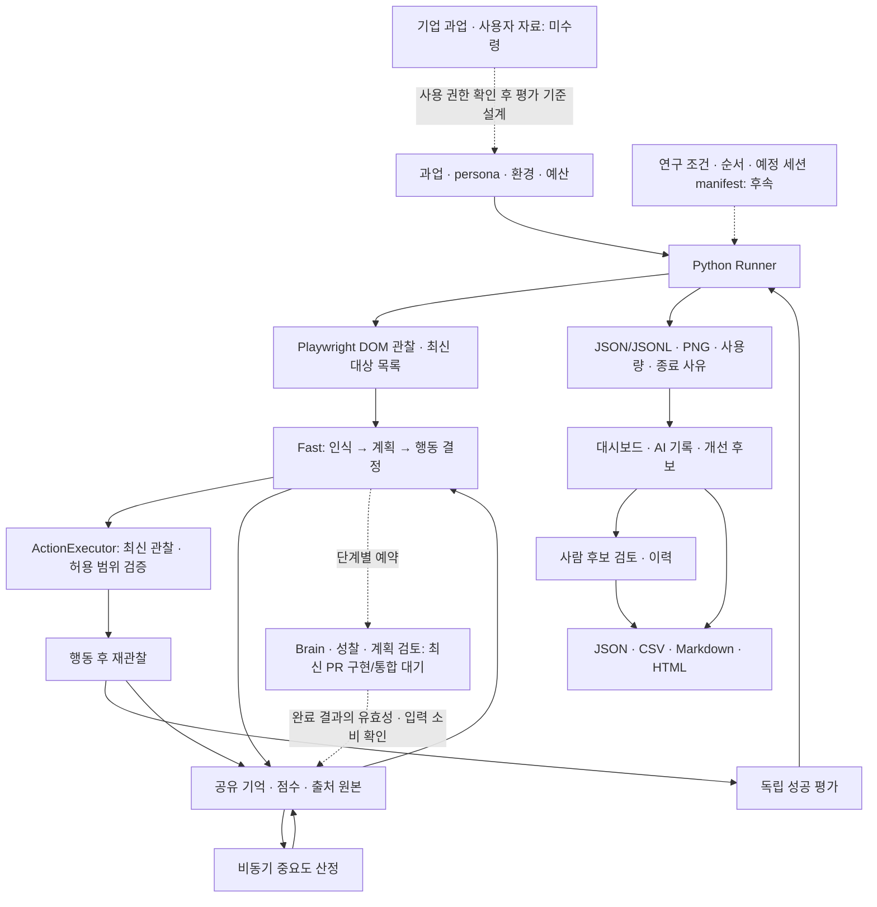

# 기업 데이터·시스템 설계·핵심 Novelty 제출 초안

작성일: 2026-10-15 KST. 23:27 KST에 원격 PR #66/#71~#79를 재확인했다. 사용자 확인: **기업체 데이터 미수령**, 수령 수량 0건. 제목·실험 조건·목표 수량은 제안이며 회의 확정 전이다. 독립 검증 preview `5ca409d`, 최신 PR의 구현 포함, prototype 미병합을 [확인 기록](../handoffs/2026-10-15-latest-github-review.md)처럼 구분한다.

## 제출란에 사용할 요약 문안

### 1. 기업체에서 받은 데이터셋 정의 및 수량

현재 기업체로부터 수령한 데이터셋은 없으며 확보 수량은 **0건**이다. 프로토타입 시연 후 멘토와 협의하여 대표 웹 과업·성공 기준, 익명화된 사용성 테스트/행동 기록, 전문가 검토 문제 목록 중 제공 가능한 자료를 확인할 계획이다. 수령 시 과업·세션·참여자·문제·파일 단위를 구분하여 실제 수량과 사용 범위를 기록한다. 자료 확보 전에는 자체 합성 웹 환경과 생성 실행 로그를 이용해 시스템 동작 및 비교 실험 절차를 검증한다. 자체 생성 자료를 기업체 데이터나 실제 사용자 자료로 기재하지 않는다.

### 2. 솔루션을 위한 시스템 구조 또는 설계안 또는 구현안

본 시스템은 페르소나와 웹 과업을 입력받아 Python/Playwright로 화면을 관찰하고, Fast Loop의 인식·계획·행동 결정에 따라 웹 행동을 수행하는 로컬 연구 도구이다. 행동은 최신 관찰과 허용 범위를 확인하는 실행기를 거치며 결과는 모델 선언과 분리된 독립 평가기가 판정한다. 공유 메모리는 관찰·계획·행동·생성 결과와 출처를 저장한다. 최신 기능 PR에는 Brain의 비동기 성찰·계획 검토 조율, 결과 채택/폐기, 단계별 검색·중요도 산정·기억 보호·Wonder가 구현돼 있다. D preview는 실행 근거·사람 검토 이력·대시보드·네 형식 출력의 연결을 검증했다. 두 계열의 최종 통합·독립 재검증과 연구용 off/빈도·검색 정책 제어는 남아 있다. 새 PR의 작성자 Mock 검증을 실제 모델 성능이나 인간 행동 재현의 증거로 사용하지 않는다.

### 3. 핵심 Novelty(논문 주제)

제안 주제는 **「페르소나 기반 웹 UX 과업에서 비동기 성찰·계획 검토의 실행 빈도와 실제 입력 소비를 고려한 성능·비용 비교」**이다. 기존 두 루프와 메모리 검색 구조를 활용하되, 성찰의 예약·완료·유효성 확인·실제 입력 전달을 구분하여 추적하고, 동일 모델·과업·페르소나·예산 아래 실행 빈도와 검색 정책을 단계적으로 비교한다. 독립 과업 성공, 제약 준수, 반복 행동, 시간·비용을 함께 분석하여 어떤 조건에서 고수준 검토가 사용되고 이득 또는 낭비가 발생하는지 설명하는 실증적 기여를 목표로 한다. 두 루프·성찰·버전 검증 자체의 최초 제안이나 인간 사용자 대체를 주장하지 않으며, 기존 연구와의 차별성은 추가 검토하고 실험 결과로 검증할 예정이다.

## 1번 항목 보충: 데이터 정의와 수량 관리

### 현재 확보 상태

| 분류 | 데이터 정의·단위 | 실제 확보 수량 | 현재 사용할 수 있는 범위 |
|---|---|---:|---|
| 기업체 제공 데이터셋 | 기업/기관이 직접 제공한 자료 묶음 | 0건 | 미수령 |
| 기업체 과업 정의 | 목표·시작 상태·제약·독립 성공 기준이 있는 과업 1종 | 0종 | 미수령 |
| 기업체 사용자 세션 | 한 참여자가 한 과업을 시도한 1세션 | 0세션 | 미수령 |
| 기업체 참여자 | 중복 제거한 실제 참여자 1명 | 0명 | 미수령 |
| 기업체 검토 문제 | 중복 제거한 전문가 검토 문제 1건 | 0건 | 미수령 |
| 자체 합성 환경·Mock 로그 | 팀이 만든 fixture/시나리오와 실행 기록 | 기업 데이터 수량에 포함하지 않음 | 회귀·시연용. 전체 유효 표본 수는 별도 목록화 필요 |
| 공개/오픈소스 자료 | 이용 조건을 확인한 외부 과업·행동·주석 자료 | 채택 데이터셋·수량 미확정 | 후보 조사 후 학습/평가 권한·중복 확인 |

스크린샷 100장, JSONL 1파일, 1사용자의 5세션은 같은 수량이 아니다. 자료 묶음/파일/세션/참여자/문제 수를 각각 센다. 합성 과업에 주입한 결함을 기업 실무의 정답 문제로 부르지 않는다. 324개 회귀 테스트도 데이터셋 표본 수가 아니다.

### 프로토타입 시연 후 협의할 자료 후보

| 요청 후보 | 있으면 가능한 비교 | 초기 협의 목표 수량 — 미확보 |
|---|---|---|
| 대표 과업·성공 조건·테스트 환경 | 실제 업무 과업에 대한 독립 성공 판정 | 과업 3~5종 |
| 익명화된 사용성/행동 세션 | 탐색 경로·제약 준수·실패 사례의 사례별 비교 | 세션 5~10건, 실제 참여자 수 별도 |
| 전문가 검토 문제 목록과 근거 | AI 후보의 유효성·알려진 문제 검출 비교 | 중복 제거 문제 10~20건 |
| 익명 사용자 유형 설명 | 과업에 맞는 persona 설정 검토 | 제공 가능한 범위 협의 |

이 목표는 멘토에게 제공 가능한 범위를 묻기 위한 시작안이며 제공 약속이나 통계적 충분성의 근거가 아니다. 화면/과업 설명만 받으면 실무 적합성 검토는 가능하지만 인간 행동 일치도 평가로 확대하지 않는다. 알려진 문제 목록이 불완전하면 전체 UX 문제 recall이라고 부르지 않고 해당 목록 내 검출로 한정한다.

수령 목록에는 제공기관·수령일·원자료/가공자료 구분·단위별 개수·중복/누락·연결 키·공유/학습/평가/논문 사용 범위·익명화 상태·보관 위치·개발/평가 분리를 기록한다. 기업 원자료·고객정보는 공개 GitHub에 올리지 않는다. 데이터가 부족하면 외부 비교를 후속으로 두고 합성 과업의 시스템 실험 범위를 명시한다.

## 2번 항목 보충: 구조와 구현 범위

실선은 검증 preview의 주요 흐름이다. Brain 점선은 **최신 PR에는 구현됐지만 D preview와 통합 대기**인 연결이며, 연구 manifest·기업 자료 점선은 후속 확장/미수령이다. 점선 전체를 미구현으로 읽지 않는다.

| 모듈 | 현재 구현/검증 | 후속 설계·구현 |
|---|---|---|
| 브라우저 관찰·실행 | viewport DOM, 최신 observation에 묶인 행동 검증 | 대상 서비스 지원 범위 확대·실환경 회귀 |
| Fast | perception/plan/decision 분리, 단계별 기억 출처 기록 | 최신 PR 수정 통합·실제 모델 평가 |
| Memory | preview의 상한/원본/중요도, 새 #76~#79의 검색·보호·종합 회귀 | 두 계열 통합·독립 재검증, 연구 정책 설정화 |
| Slow/Brain | 새 #66/#71~#74에 성찰·검토·채택/폐기·평가·Wonder·제공자 기록 구현 | D 통합, off/빈도·중요도 독립 제어, 실제 입력 포함 검증 |
| 독립 평가 | 합성 fixture 및 명시된 공개 부분 과업 | 기업 과업 정답/독립 기준 확보 후 확장 |
| 검토·대시보드·출력 | D의 저장/이력/출력 검증과 새 #75의 Brain/Wonder 소비 구현 | 중복 구현·8상태 계약 조율, 연구 소비/지연 집계 |
| 비교 실행 | 일반 AI/페르소나 비교, 새 #74 이후 Slow 입력 격리 지원 | 성찰 빈도/검색 정책용 manifest와 격리 실행 |

기록은 관찰 사실, AI 생성 전략, 행동 제안, 실제 실행 결과, 독립 성공 평가, 사람 검토를 구분한다. AI confidence는 검증된 정답 확률이 아니다. Slow는 브라우저를 직접 조작하지 않고 오래된 요소 ID를 그대로 실행하지 않는다. 기업의 평가 정답은 모델 프롬프트에 넣지 않는다.

## 3번 항목 보충: 기여 후보와 검증

| 내용 | 주장 수준 | 검증 자료 |
|---|---|---|
| 두 루프·성찰·I/Q/R 검색 | 기존 연구에서 가져온 기반 | UXAgent 등 원문 인용 |
| 버전/출처 확인·오래된 결과 배제 | 신뢰성 설계 요구, 자체 신규 알고리즘으로 주장하지 않음 | 관련 연구 대조·fake provider 경계 회귀 |
| 페르소나 웹 과업의 예약 빈도 비교 | 실증적 기여 후보 | 동일 조건의 off/5차례/매차례 대응 실험 |
| 생성 완료와 실제 입력 소비의 구분 | 비용·효과를 설명할 분석 축 | 작업 사건·유효 판정·소비된 요청 ID 연결 |
| 검색 정책을 별도 단계로 비교 | 복합 변경을 분리하는 실험 설계 | 실행 주기 고정 후 관련성/중요도 비교 |
| 기업 실무·사람 결과와 비교 | 자료 확보 후의 확장 | 현재는 기업·사람 자료 0건, 검증 전 |

단순 가중치 튜닝이나 Slow on/off만으로 충분한 논문 신규성이 확보됐다고 보지 않는다. [관련 연구 근거](2026-10-15-novelty-evidence.md)를 바탕으로 가까운 실험과의 차이를 계속 확인하고, 파일럿에서 실제 지연·미소비가 발생하는지 먼저 점검한다. 문제가 거의 드러나지 않으면 더 긴 과업/상태 변화가 있는 평가를 설계하되 개발·평가 분리를 지키고, 결과를 본 뒤 주장을 임의로 바꾸지 않는다.

초기 성공 기준은 실행 빈도별 성과와 비용을 비교 가능한 형태로 확보하고, 완료됐지만 사용되지 않은 검토·오래되어 제외된 결과·예산 중단을 설명하는 것이다. 성능 향상이 없더라도 해당 과업·모델·예산 범위의 결과로 보고한다. 인간 유사성을 높였다는 결론은 실제 인간 자료와 별도 평가 없이 내리지 않는다.

## 제출 전 확인 목록

- 팀이 연구 제목·주 비교·주 지표와 제출 일정을 확정했는가?
- 기업 데이터는 여전히 미수령 0건인지, 수령했다면 단위별 실제 개수·권한을 갱신했는가?
- 새 PR의 Brain/Slow 구현을 미구현으로 쓰거나, 미병합/독립 재검증 대기를 통합 완료로 쓰지 않았는가? 연구용 실행 제어의 추가 범위는 분리했는가?
- 실험의 18/90/216세션을 확보 데이터나 실제 참가자 수로 오해할 표현이 없는가?
- 가까운 선행과 겹치는 구조를 Novelty라고 부르지 않았는가?
- 유료 모델·기업 비교·사람 재현성의 수행 여부를 정확히 적었는가?

관련 문서: [실험 계획](2026-10-15-slow-loop-experiment-plan.md), [회의 안건·결정표](../meetings/2026-10-15-research-and-data-agenda.md), [구조](../architecture.md), [계약](../contracts.md), [검증 기록](../verification.md).
