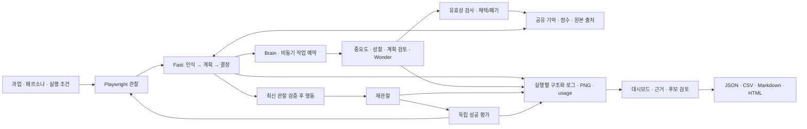

# 제출 3항목·연구 방향 결정 자료 — 2026-10-16

이 문서는 팀 대화를 반영한 [기존 실험 계획](2026-10-15-slow-loop-experiment-plan.md)과 [회의 안건](../meetings/2026-10-15-research-and-data-agenda.md), 최신 통합 코드를 기준으로 정리한 **회의 전 결정 자료**다. 팀 전체가 제목·조건·담당·기한에 합의했다는 회의록이 아니다. 기업 자료는 사용자 확인 기준 **미수령, 0건**이다.

현재 기준선은 [통합 PR #81](https://github.com/2026-2-1/Persona/pull/81)의 `a031932`이며, #79 + #78/#75 후속과 D/C를 통합했다. 로컬·Ubuntu·Windows에서 각각 403개 검사가 통과했다. 실제 무료 Mock/합성 결함의 기록·검토·출력 검증과 실제 유료 모델·기업·사람 평가를 구분한다. B #58/#60/#62와 prototype/main 반영은 이번 검증에 포함되지 않았다. [통합 근거](../handoffs/2026-10-16-latest-pr-integration.md)

## 1. 지금 확정 사실로 쓸 내용과 회의에서 확정할 내용

| 구분 | 현재 판단 | 근거·회의에서 할 일 |
|---|---|---|
| 기업 데이터 수령 | **미수령, 0건**으로 작성 가능 | 사용자의 직접 확인. 목표 수량과 구분한다. |
| 현재 시스템 | Python/Playwright + Fast/Slow/Brain + 공유 기억 + 독립 평가 + 검토/출력 | 통합 브랜치에서 구현·무료 검증됨. [코드와 구조](../architecture.md) |
| 시연 가능 범위 | 생성·관찰·실행·독립 평가·사람 검토·네 형식 출력 연결 | 합성·Mock 근거이며 실제 인간 행동 재현을 의미하지 않는다. |
| 기존 두 루프의 신규성 | **두 루프를 만들었다는 사실만으로 Novelty라고 쓰지 않음** | UXAgent·DPT-Agent 등 선행에 비동기 구조가 있다. 아래 원문 근거 참조. |
| 연구 중심축 | **검토가 언제 유효한 입력으로 전달되는지와 성과·비용의 관계**를 권고 | 팀 확정 전 제안이다. 기능 구현과 논문 기여를 구분한다. |
| 데이터 요청 방식 | 프로토타입·실제 출력 시연 후 멘토에게 제공 가능한 범위 확인 | 사용자가 제안한 진행 방향. 구체적 자료·수량·권한은 미확정이다. |
| 사람 비교·파인튜닝 | 후속 후보로 유지 | 인간 자료·적합한 공개 자료·별도 평가셋이 아직 확보되지 않았다. 1차 실험과 동시에 바꾸지 않는 안을 권고한다. |

팀 대화의 출발점인 기억 상한 64개·검색 가중치·호출 한도 중 **64는 현재 구현 기본값**이고 최적값이라는 결과는 없다. 현재 Slow 검색은 중요도/관련성/최신성 순서로 `(0.2, 0.2, 0.6)`이며, 논문에서 설명하는 Slow 관련성 강조 및 팀의 중요도 강조 가설과 구분해야 한다. 요청·토큰 한도의 기본값은 무제한이므로, 실제 유료 실험 전에 공통 한도와 총 지출을 별도로 정해야 한다. [현재 계약](../contracts.md), [메모리 구현](../../src/uxagent/memory.py), [실험 계획](2026-10-15-slow-loop-experiment-plan.md)

## 2. 제출 항목 1 — 기업체에서 받은 데이터셋 정의 및 수량

### 그대로 사용할 문안

현재 기업체로부터 수령한 데이터셋은 없으며 확보 수량은 **0건**이다. 프로토타입 시연 후 멘토와 협의하여 대표 웹 과업·성공 기준, 익명화된 사용성 테스트/행동 기록, 전문가 검토 문제 목록 중 제공 가능한 자료를 확인할 예정이다. 수령 시 자료 묶음·과업·사용자 세션·참여자·문제·파일 수를 각각 기록하고, 학습·평가·논문 공개에 허용된 범위를 확인한다. 자료 확보 전에는 팀이 만든 합성 웹 환경과 Mock/실행 로그를 이용해 시스템 동작과 실험 절차를 검증하며, 이를 기업 데이터 또는 실제 사용자 데이터로 기재하지 않는다.

### 수량 표기 기준

| 자료 | 정의·집계 단위 | 기업체에서 실제 수령한 수량 |
|---|---|---:|
| 기업 제공 데이터셋 | 제공기관이 전달한 구분 가능한 자료 묶음 | 0건 |
| 과업 정의 | 목표·시작 상태·제약·독립 성공 기준을 갖춘 과업 | 0종 |
| 사용자 행동/사용성 세션 | 한 참여자가 한 과업을 시도한 기록 | 0세션 |
| 참여자 | 중복 제거한 실제 참여자 | 0명 |
| 전문가 검토 문제 | 중복 제거한 문제·근거의 연결 | 0건 |

합성 로그, 공개 데이터, 회귀 테스트 수는 위 표에 합산하지 않는다. 실제 Mock의 생성 60건·작업 사건 193건도 기업 세션·참여자 수가 아니다. 18세션 파일럿·90세션 평가·216세션 전체안 역시 **예정 AI 실행 수량**이며 이미 확보한 자료가 아니다. [실험 규모의 정의](2026-10-15-slow-loop-experiment-plan.md#8-규모와-단계별-통과-기준)

멘토 시연 뒤에는 먼저 **자료 종류와 사용 가능 범위**를 확인한다. 과업 3~5종, 익명 세션 5~10건, 문제 목록 10~20건은 협의를 시작하기 위한 제안 수량으로만 사용한다. 과업 설명만 받으면 실무 과업 적합성 검토, 문제 목록을 받으면 알려진 문제에 대한 후보 대응 분석, 같은 과업의 인간 행동 기록까지 받으면 행동 차이 분석이 가능하다. 서로 다른 자료를 받아 동일한 인간 유사성 평가를 할 수 있다고 쓰지 않는다. [데이터 요청 안건](../meetings/2026-10-15-research-and-data-agenda.md#멘토에게-프로토타입을-보여준-뒤-확인할-질문)

## 3. 제출 항목 2 — 솔루션의 시스템 구조·설계·구현

### 그대로 사용할 문안

본 시스템은 페르소나와 웹 과업을 입력받아 웹 인터페이스를 실행·관찰하고, 문제 후보와 그 근거를 연구자가 검토할 수 있게 하는 로컬 연구 도구이다. Python/Playwright가 화면 내 DOM과 실행 결과를 수집하고, Fast Loop가 인식·계획·행동 결정을 수행한다. 실행기는 최신 관찰과 허용 범위를 확인한 행동만 수행하며, 성공 여부는 모델의 완료 선언과 분리된 독립 평가기가 판정한다. Brain은 비동기 중요도 산정·성찰·계획 검토·Wonder와 공유 기억을 조율하고 결과의 출처·유효성·채택/폐기를 기록한다. 대시보드는 원본 관찰, 생성 기록, 실행 결과, 독립 평가, 사람의 후보 검토 이력을 구분하여 제공하며 JSON·CSV·Markdown·HTML로 내보낸다. 현재 통합 브랜치에서 무료 Mock/합성 환경의 연결과 화면·출력 일치를 검증했으며, 연구용 실행 정책 제어·실제 입력 소비 계측과 실제 모델/기업 평가를 후속으로 진행한다.

위 그림은 현재 연결된 구현 흐름이다. 모든 Slow 결과가 다음 입력에 전달된다는 뜻은 아니다. 계획 검토의 현재 채택 대상은 동일 observation/plan/version의 decision 경계다. 채택 사건과 실제 요청 입력 포함을 별도로 계측해야 한다. 근거 연결은 모델이 그 입력 때문에 행동했다는 인과 증명이 아니다. [Brain](../../src/uxagent/brain.py), [Fast 입력 구성](../../src/uxagent/fast_loop.py), [통합 소비 계약](../tasks/d-brain-trace-viewer.md)

| 구분 | 현재 완료·검증 | 다음 범위 |
|---|---|---|
| 관찰·행동·평가 | 로컬 합성 과업과 일부 공개 과업에 명시된 독립 기준 적용 | 기업 과업·실환경의 평가 기준 확보 |
| Fast/Slow/Brain | 단계별 생성·8상태·출처·기억 정책·비동기 조율 통합 | 계획 검토의 반영 시점 합의, 실제 모델 지연 검증 |
| 대시보드·검토·출력 | #75/D 중복을 단일 읽기·패널로 통합, 저장/새로고침/출력 일치 | 연구 조건·입력 소비·지연 집계 |
| 재현 | 403개 검사와 무료 Mock/합성 화면 검증 | 팀원 독립 재현·prototype 반영, 유료 모델 파일럿 |
| 연구 실행 | 기존 일반/persona 비교 제공 | 중요도 산정과 고수준 검토의 독립 제어, 조건·순서·예산 manifest |

원자료와 관찰 사실, AI가 생성한 전략, 실행된 행동, 독립 평가, 사람 검토를 합치지 않는 것이 시스템의 검증 기준이다. 현재 시스템 자체를 인간 참가자의 대체나 실무 UX 진단의 정확성 검증 완료로 표현하지 않는다. [데이터·판정 계약](../contracts.md)

## 4. 제출 항목 3 — 핵심 Novelty·논문 주제

### 권고 제목과 연구 질문

**권고 작업 제목:** 「페르소나 웹 에이전트에서 비동기 계획 검토의 유효성·입력 소비와 성능·비용의 관계」

**주 연구 질문:** 비동기 성찰·계획 검토가 생성된 뒤, 현재 과업에 유효한 상태로 실제 모델 입력에 전달되는 비율은 무엇에 의해 달라지며, 그 차이가 독립 과업 성공·제약 준수·시간·비용과 어떤 관계를 보이는가?

제목과 질문은 팀이 채택할 후보다. 현재 Mock 한 건의 폐기 사례로 실제 모델에서의 효용이나 보편적인 문제를 입증한 상태는 아니다.

### 그대로 사용할 문안

본 연구는 페르소나 기반 웹 에이전트의 비동기 성찰·계획 검토에서 생성 완료와 실제 의사결정 입력 포함의 차이를 분석하는 것을 목표로 한다. 예약·완료·유효성 검사·채택/폐기·입력 전달을 연결하여, 검토 결과가 늦게 도착하거나 계획/화면이 바뀌어 사용되지 않는 경우를 구분하고 성능과 비용을 함께 평가한다. 동일 모델·과업·페르소나·메모리·예산 아래 실행 정책을 비교하여, 어떤 조건에서 고수준 검토가 유효하게 전달되고 어떤 조건에서 비용만 증가하는지 설명하는 실증적 기여를 추구한다. 새로운 반영 정책을 제안할 경우에는 현재의 동일 계획 검토 정책과 사전 명세한 비교 조건으로 검증한다. 두 루프·성찰·메모리 검색 자체의 최초성이나 인간 판단 재현을 주장하지 않으며, 학술적 차별성과 성능 개선은 선행 대조와 실제 모델 실험으로 확인한다.

### 기여를 구체적으로 만드는 세 가지 산출물

1. **전달 경로 계측:** 작업/생성/기억/요청 ID와 계획 버전을 연결하여, 완료됐지만 전달되지 않은 결과와 실제 입력에 포함된 결과를 구분한다. 단순 완료율을 검토 효과라고 부르지 않는다.
2. **상태 변화·지연별 분석:** 유효 창, 작업 대기/생성 지연, 계획·관찰 변경과 종료를 구분해 미소비 원인을 분석한다. 비용에는 폐기 결과·중요도·재시도·fallback까지 포함한다.
3. **정책의 통제 비교:** 우선 현재 정책을 기준선으로 고정한 후 실행 빈도만 비교한다. 다음 계획에 일반적 교훈을 전달하는 별도 정책을 선택한다면, 과거의 요소 ID/행동 명령 재사용 없이 새 관찰에서 다시 판단하도록 명세하고 별도 개발·평가 과업에서 비교한다. 가중치 비교는 그 뒤로 둔다.

위 산출물이 추가된다고 새로운 알고리즘의 독창성이 자동으로 성립하지 않는다. 일정상 새 정책을 구현·평가하기 어렵다면, **입력 소비를 포함한 실증 분석**으로 논문 범위를 낮추는 것이 타당하다. 단순 on/off·몇 개 가중치 변경만으로 강한 Novelty를 약속하지 않는다.

실험 시작 전에는 현재 runner에서 계획 검토가 유효한 decision 입력에 도달할 수 있는지부터 검증해야 한다. 구현의 실행 순서 문제를 남긴 상태에서 빈도별 효과를 비교하거나, 그 구현 결함과 Mock의 미소비 자체를 논문 신규성으로 주장하지 않는다. 반영 정책의 의미를 정하고 실제 입력 도달을 검증한 기준선에서 비교한다.

### 가까운 선행과 이번 주장 범위

| 직접 확인한 원문 | 확인한 선행 | 이번 연구가 구분해야 할 것 |
|---|---|---|
| [UXAgent v3 §3.2.1·§5.4](https://arxiv.org/html/2504.09407v3) | Fast/Slow 비동기 공유 기억과 결과 뷰어를 제공한다. 사람과 에이전트의 쇼핑 행동 정량 비교는 한계로 남긴다. | 페르소나·두 루프·뷰어를 새 원리로 주장하지 않는다. 인간 유사성은 별도 자료와 평가가 필요하다. |
| [DPT-Agent v2 §4.1.2·§4.2·§5–6](https://arxiv.org/html/2502.11882v2) | 비동기 성찰 지침을 System 1에 연결하고 게임에서 성능·지연을 비교한다. | 비동기 성찰로 성능·지연 균형을 본다는 주장만으로 차별화하지 않는다. 웹 과업의 유효 창·실제 입력 소비에 초점을 맞춘다. |
| [Generative Agents v2 §4.2·§6.5.1](https://arxiv.org/html/2304.03442v2) | 중요도 임계값에 따라 성찰을 만들고, 성찰·계획·기억 제거 조건을 비교한다. | 중요도 발동·성찰 on/off 자체는 선행이다. 실제 웹 과업과 호출 예산 범위의 차이를 실험으로 설명해야 한다. |

2026-10-16에 위 세 원문을 다시 확인했다. 이는 가까운 선행을 확인한 제한된 조사이며 관련 연구 부재나 최초성의 증거가 아니다. 버전/출처 검증을 다룬 추가 선행과 기존 주제 비교는 [Novelty 근거 문서](2026-10-15-novelty-evidence.md)를 따른다.

## 5. 빠르게 논의해야 할 안건과 권고 순서

| 우선순위 | 결정 질문 | 권고안·완료 조건 |
|---|---|---|
| **P0 · 실험 전** | 계획 검토는 같은 행동을 고칠 것인가, 다음 계획을 참고하게 할 것인가? | 현재 동일 계획 decision 정책을 명확히 설명한다. 다음 계획 참고는 별도 정책 ID·입력·유효 조건으로 설계한다. 6건 폐기 진단을 근거로 반영 시점부터 합의한다. |
| **P0 · 실험 전** | 완료·채택·실제 입력 소비를 어떻게 구분할 것인가? | 고유 결과 ID 기준의 단계별 분모와 실제 요청 입력 ID를 기록한다. 종료로 소비 기회가 없던 건을 별도 보고한다. |
| **P0 · 제출 전** | 논문이 과업 수행 연구인가, 인간 유사성 연구인가? | 1차는 과업 수행·제약·비용으로 좁히는 안을 권고한다. 사람 비교·파인튜닝은 데이터가 준비된 후 확장한다. |
| **P0 · 유료 실행 전** | 연구 조건과 예산은 무엇인가? | 중요도 공통 유지, 고수준 검토 off/5차례/매차례, Wonder·오류 추가 발동 off를 시작안으로 검토한다. 조건별 동일 모델/상한과 전체 지출을 확정한다. |
| **P1 · 10/18 시연 전** | 어떤 버전을 시연하고 누가 독립 재현하는가? | PR #81 검토와 팀원 재현 후 commit을 동결한다. B 미통합/실제 API 미검증을 시연 자료에 표시한다. |
| **P1 · 멘토 시연 전** | 기업에 무엇을 확인할 것인가? | 정상/결함 근거·검토/출력 시연 뒤 자료 종류·수량 단위·평가/논문 권한을 확인한다. 제출 수량은 현재 0건으로 유지한다. |
| **P1 · 파일럿 전** | 최소 실행 규모와 계속 기준은 무엇인가? | 18세션 개발 파일럿을 제안한다. 입력 전달·usage·평가 분모가 검증된 뒤 평가 과업/규모를 동결한다. 파일럿 수를 실측 데이터로 미리 쓰지 않는다. |
| **P2 · 1차 분석 후** | 검색 정책·상한·파인튜닝까지 확장할 것인가? | 1차 결과와 일정/예산을 보고 선택한다. 실행 빈도·검색·모델 학습을 동시에 바꾸지 않는다. |

최소 회의 산출물은 **주 질문 1개, 계획 검토 반영 시점, 소비 지표 정의, 시연 commit, 파일럿 조건·예산, 멘토 질문 목록**이다. 실제 합의 후 담당·기한·보류 사유를 [회의 결정표](../meetings/2026-10-15-research-and-data-agenda.md#회의-결정표--회의-후-작성)에 기록하고 관련 Issue의 완료 조건으로 옮긴다.

## 확인 범위

- 직접 확인: 위 세 논문 원문, 현재 저장소의 Brain/Fast/Memory 소스, 최신 통합 기록과 기존 연구·회의 문서.
- 수행하지 않은 것: 유료 모델 재실험, 신규 기업 자료 수령, 사람 비교, 파인튜닝, 논문 결과 재현, 팀의 새 합의.
- 이번 문서는 기존 제출 초안의 사실 범위를 유지하며 회의에서 선택할 우선순위와 논문 기여 후보를 좁힌 것이다.
